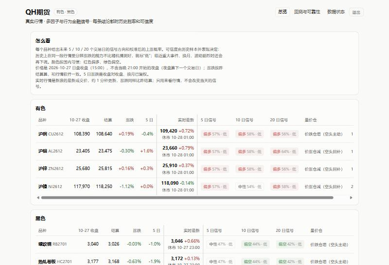
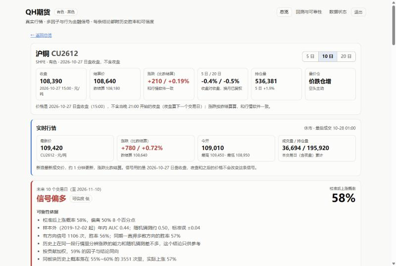
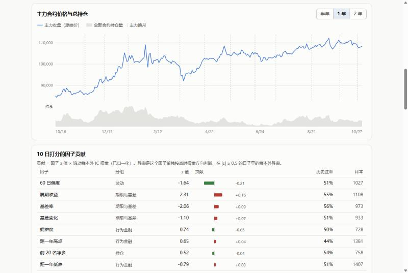
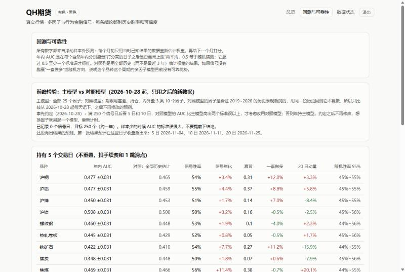

# QH期货：国内期货多因子研究系统

[English](README.md)

覆盖 9 个国内期货品种：上期所的铜、铝、锌、镍、螺纹、热卷，大商所的铁矿石、焦炭、焦煤。每个交易日自动采集真实数据，计算 25 个计分因子，用滚动样本外训练预测未来 5 / 10 / 20 个交易日的方向。每条信号都附上**用统计算出来的可靠性**：历史样本外胜率、AUC、相似情形和降级条件。

**结论如实写在最前面：** 严格的样本外检验下，这套多因子模型**没有可靠优势**，27 个"品种 × 周期"组合中有 26 个年内 AUC 低于 0.5，所以网站上的信号都标"可信度低"。2026-10-28 起，另外对一个精简模型做事先约定规则的前瞻检验，只用之后才出现的新数据。

| 总览 | 品种页 |
|---|---|
|  |  |
| **走势图与因子贡献** | **回测与前瞻检验** |
|  |  |

*截图为 2026-10-27 的数据，信号只是研究输出，不构成投资建议。*

## 功能

- **数据**：经 AKShare 采集 10 个公开数据源，带重试、抓取日志、断点续传和新鲜度记录。数据包括：
  - 全部合约日线、前 20 名会员持仓、上期所仓单
  - 现货与基差、LME / 新加坡外盘、美元汇率
  - 快讯、交易规则与手续费

  时间从 2019 年 1 月到现在，约 19 万条合约日线。
- **主力连续**：按前一日持仓量选主力，只向后换月；比例复权，换月不出现假跳空。
- **25 个计分因子**，分 8 组：
  - 趋势
  - 期限与基差
  - 库存
  - 持仓
  - 内外盘：国内外比价、外盘领先、主动买卖近似
  - 产业链利润
  - 波动
  - 行为金融：过度反应、处置效应、锚定、拥挤度

  全部只用信号日北京时间 16:30 之前能拿到的数据。
- **模型**：滚动 Spearman IC 加权。
  - 每月初只用最近 3 年里结果已知的样本重估权重。
  - IC 按有效样本数收缩，品种和板块各占一半。
  - 用保序回归把打分校准成上涨概率。
  - 另保留梯度提升模型和"全部历史估计权重"两个版本做对照。
- **可靠性**（确定性规则）：每条信号给出
  - 年内 AUC ± 标准误
  - 胜率和"一直押多数方向"的对比
  - 和近期上涨比例的对比
  - 因子一致性
  - 同档位历史命中率
  - 彼此间隔至少 h 天的相似情形

  遇到以下情况会降低可信度：临近重大事件（美联储议息、PMI、CPI、非农）、主力换月、波动率高、接近涨跌停、成交清淡、数据缺失或不是最新。
- **回测**：持仓不重叠，扣手续费和 1 跳滑点，和一直做多、20 日动量、随机方向对比。
- **网页**（FastAPI + 原生 JS / SVG）：
  - 价格口径和行情软件一致：涨跌比昨结算，注明是哪天的日盘收盘
  - 新浪实时行情，所有访问者共用 60 秒缓存，和信号日数据分开显示
  - 走势图、因子表、可靠性依据、数据状态页
  - 整站口令（HMAC 签名 Cookie，同一 IP 输错有次数限制）
- **大模型功能（可选）**：通过 Anthropic API
  - 用 Claude 联网搜索按品种汇总消息，附来源
  - 再用一次结构化输出抽取条目
  - 写中文解读时，数字只能来自计算结果
  - 没有 API key 时用模板
  - 有离线测试（伪造 HTTP 响应）

## 结论（2019-11 ~ 2026-10，样本外）

| 检验 | 结果 |
|---|---|
| 年内 AUC，9 个品种 × 3 个周期 | 27 个中 26 个低于 0.5（0.36~0.51）；最好的镍 5 日 0.508，也在一个标准误以内 |
| 单因子胜率和随机猜比，564 个"品种 × 周期 × 因子"组合 | 显著为正（z > 2）0 个，显著为负 9 个；纯靠运气两边各约 13 个 |
| 去掉仓单因子重跑（上期所品种） | AUC 平均变化 0.002，最大 0.056，全部在一个标准误以内 |
| 扣费后的信号策略 | 多数为正，但主要来自 2019~2026 年的上涨趋势，多数不如一直做多 |

**AUC 为什么低于 0.5**：商品因子的方向随行情阶段变化。2019~2021 年动量和增仓有效，2022 年以后多数转为反转，用过去估计的权重去预测下一个月，往往正好反了。看到结果后再把信号反过来用，属于事后挑方向，所以没有这样做。

### 事先约定的前瞻检验

事后看，基差、持仓、内外盘几类因子平均略好于随机。但这正是历史回测不能当证据的情况，所以 2026-10-28 起改做**前瞻检验**：

- **对照模型 B**：只用这 3 类共 10 个因子，其余方法和主模型 A 完全一样。
- **记录**：两个模型的预测每天写进**只增不改**的记录表，以后重新训练也不会改动已经记下的预测。
- **判定规则（事先约定）**：满 250 个信号日后看 5 日和 10 日，B 的 AUC 比 A 高出两个标准误以上，才考虑改用 B。

因子清单由测试锁定，代码在 `futures_analyst/forward.py`。

## 工程

- **每日流水线**：探测数据源 → 拉回原始库 → 补缺 → 重训两个模型 → 导出网页数据 → 上传 → 过期检查。在 GitHub Actions 上运行，约 6 分钟，示例见 [`deploy/daily-update.yml`](deploy/daily-update.yml)。
- **过期提醒**：任何品种的任何一项数据落后 3 个交易日及以上，任务就失败，GitHub 会发邮件。阈值按两年真实数据校准过：回看两年只会报一次，是一次真实的 7 天焦炭排名缺失。
- **部署**：批处理和网站分开。批处理把一个只读的小 SQLite 文件传到 Hugging Face 私有数据集，Hugging Face Spaces 上的 Docker 网站启动时和每小时拉取一次。见 [`deploy_hf.py`](deploy_hf.py)、[`Dockerfile`](Dockerfile)。
- **测试**：19 个离线测试，每次推送都会在 CI 里自动运行。覆盖：
  - 不偷看未来：数据截断到某天重算，那天的因子值必须不变
  - 滚动训练只用已知结果
  - 换月不跳空
  - 可靠性规则
  - 换月当天的昨结算口径
  - 过期检查
  - 前瞻记录只增不改
  - 网页口令与次数限制
  - 实时行情解析
  - 大模型调用（伪造 HTTP 响应）
- **技术栈**：Python 3.12、pandas、NumPy、scikit-learn、AKShare、SQLite（WAL）、FastAPI、原生 JS / SVG、GitHub Actions、Hugging Face Spaces / Datasets、Anthropic SDK。

## 本地运行

```bash
python -m venv .venv
.venv/bin/pip install -r requirements.txt          # Windows 用 .venv\Scripts\pip
cp .env.example .env                               # 可选：口令、API key
.venv/bin/python main.py probe                     # 探测数据源能否访问
.venv/bin/python main.py init                      # 回补历史（首次 1~2 小时，可断点续跑）
.venv/bin/python main.py train                     # 滚动训练、回测、导出网页数据
.venv/bin/python main.py report CU                 # 在终端看某品种的最新信号和理由
.venv/bin/python main.py backtest                  # 回测与基准对比
.venv/bin/python -m uvicorn web.app:app --port 7860
.venv/bin/python -m pytest tests -q
```

## 目录

```
futures_analyst/   数据源、采集、主力连续、因子、模型、可靠性、回测、前瞻检验、过期检查、消息与大模型、导出
web/               FastAPI 网站、实时行情、前端（原生 JS、SVG 图表）
tests/             离线测试
deploy/            每日更新的 GitHub Actions 示例
main.py            命令行：probe / init / update / train / backtest / report / publish / check
```

## 说明

- 这是个人研究项目，开发时用 Claude Code 做 AI 结对编程，提交记录里标注了共同作者。
- 仓库不包含任何数据。数据经 AKShare 来自公开网站，使用时须遵守各网站的条款。转发交易所实时行情一般需要授权，所以实际部署的网站设了口令，只给少数人用。
- 本项目不构成投资建议。网站措辞用"信号偏多/偏空 + 历史胜率"，不写"建议做多/做空"。
